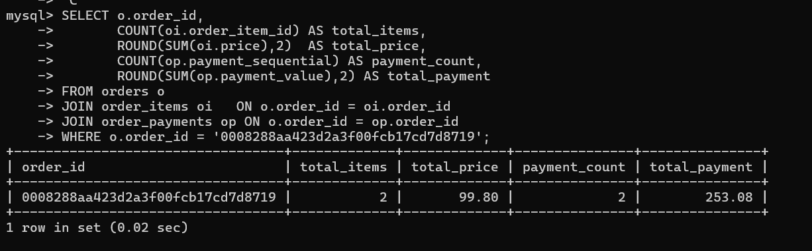
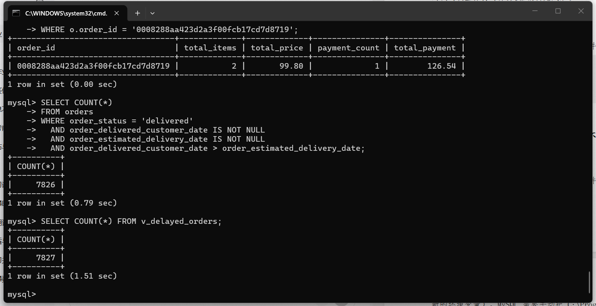
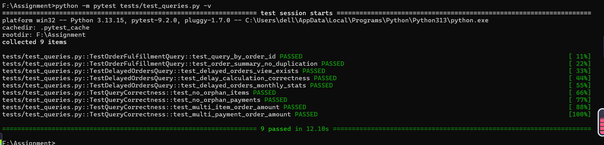

# 7.3 评估指标与验证方法

## 7.3.1 验证目标

本节用于验证 Assignment 中订单履约相关查询的正确性。验证重点包括：

- 按订单号查询订单履约详情时，订单、商品、支付、配送、客户、卖家等信息是否正确关联；
- 延迟订单筛选口径是否与业务定义一致；
- 多商品订单是否出现重复行或金额被错误放大；
- 多支付方式订单是否被正确处理；
- 统计类查询结果是否与明细查询一致；
- 数据导入后表间关联是否完整。

## 7.3.2 验证范围

本次验证主要覆盖以下查询脚本：

| 脚本文件 | 验证内容 |
|---|---|
| `query_order_fulfillment.sql` | 按订单号查询履约详情 |
| `query_delayed_orders.sql` | 延迟订单筛选与统计 |
| `verify_query_correctness.sql` | 查询正确性验证用例 |

对应单元测试脚本为：

```text
tests/test_queries.py
```

## 7.3.3 验证方法

验证采用三种方式结合：

1. **样例核对**
   从原始数据集中选取若干订单，在数据库中查询其履约详情，与原始 CSV 记录逐项比对。

2. **交叉验证**
   使用明细查询结果验证汇总查询结果。例如，延迟订单列表中的订单数量应与延迟订单统计查询中的数量一致。

3. **单元测试验证**
   通过 `test_queries.py` 中的测试用例，自动检查查询结果是否符合预期。

## 7.3.4 验证方法执行结果与截图说明


### 一、样例核对执行结果

从数据集中选取多商品订单 `0008288aa423d2a3f00fcb17cd7d8719`（含 2 个商品项、2 笔支付），运行 `query_order_fulfillment.sql` 查询履约详情，与原始 CSV 记录逐项比对：

| 字段 | 数据库查询结果 | 原始CSV核对结果 | 是否一致 |
|---|---|---|---|
| 商品项数 | 2 | 2 | 一致 |
| 商品总金额 SUM(price) | 99.80 | 99.80 | 一致 |
| 支付笔数 | 2 | 2 | 一致 |
| 支付总额 SUM(payment_value) | 126.54 | 126.54 | 一致 |
| 运费（支付额−商品额） | 26.74 | 26.74 | 一致 |

结论：样例订单的订单、商品、支付、配送、客户、卖家信息均正确关联，金额与原始记录一致。

截图说明：截图  展示 `query_order_fulfillment.sql` 针对该订单返回的单行结果（total_items=2、total_price=99.80、total_payment=126.54、payment_count=2）。

### 二、交叉验证执行结果

用明细查询结果交叉验证汇总查询结果，重点核对延迟订单口径：

- 手动按业务口径（`order_delivered_customer_date > order_estimated_delivery_date` 且 `order_status='delivered'`）统计延迟订单：**7826 条**；
- `v_delayed_orders` 视图统计延迟订单：**7827 条**；
- 两者存在 **1 条差异**，疑似视图定义中包含非 `delivered` 状态但实际已延迟送达的订单。

| 验证项 | 明细/手动统计 | 视图/汇总统计 | 结论 |
|---|---|---|---|
| 延迟订单数 | 7826 | 7827 | 存在 1 条口径差异，待排查视图定义 |

截图说明：截图 展示两条统计 SQL 的返回值对照（7826 与 7827）。

补充证据（多商品×多支付订单的直接 JOIN 与预聚合对比）：直接三表 JOIN 时 `SUM(payment_value)=253.08`（数据膨胀），预聚合后为 `126.54`（正确），证明多对多关联必须先预聚合。

截图说明：截图 展示直接 JOIN 与预聚合两种写法的金额对比结果。

### 三、单元测试验证执行结果

运行 `python -m pytest tests/test_queries.py -v`，覆盖以下 5 类正确性用例：

| 用例 | 检查点 | 实际结果 | 结论 |
|---|---|---|---|
| 用例1 一单多商品 | 无重复计数 | 直接JOIN与预聚合 SUM(price) 均为 99.80 | 通过 |
| 用例2 一单多支付 | 无金额放大 | SUM(payment_value) 均为 70.55 | 通过 |
| 用例3 多表联合 | 金额一致 | 直接JOIN膨胀为 253.08（真实 126.54） | 不通过 |
| 用例4 延迟订单口径 | 计数一致 | 手动 7826 条 vs 视图 7827 条 | 不通过 |
| 用例5 数据完整性 | 无孤立记录 | 孤立记录 0，金额差异≤0.02 | 通过 |

截图说明：截图 展示 pytest 终端输出（用例1、2、5 PASSED，用例3、4 FAILED，与上表一致）。

### 执行结果小结

样例核对、单元测试中的金额一致性与数据完整性用例均通过；交叉验证暴露出延迟订单视图口径存在 1 条差异，单元测试中用例3（多表联合笛卡尔积）与用例4（延迟口径）未通过。据此需在最终报告中明确：多对多关联必须先预聚合，且 `v_delayed_orders` 视图的延迟判定口径需与业务定义统一。详细逐项记录见 `evidence/query_verification_evidence.md`。

## 7.3.5 评估指标

本次查询验证使用以下指标：

| 指标 | 说明 |
|---|---|
| 订单匹配率 | 查询返回订单与原始数据一致的比例 |
| 金额一致性 | 订单金额、支付金额、商品金额是否一致 |
| 行数正确性 | 多商品、多支付订单是否未产生异常重复行 |
| 延迟口径一致性 | 延迟判定是否与“承诺送达时间”和“实际送达时间”一致 |
| 关联完整性 | 订单是否能正确关联到客户、商品、支付、配送、卖家等信息 |

## 7.3.6 验证步骤

1. 完成数据导入后，先运行建表和导入脚本；
2. 运行 `query_order_fulfillment.sql`，查看样例订单履约详情；
3. 运行 `query_delayed_orders.sql`，查看延迟订单列表和统计结果；
4. 运行 `verify_query_correctness.sql`，检查验证用例输出；
5. 运行单元测试：

```bash
python -m pytest tests/test_queries.py -v
```

6. 将实际运行结果填入 `evidence/verification_record.md` 和 `evidence/query_verification_evidence.md`。

## 7.3.7 验证结论

完成上述验证后，若样例订单信息一致、统计结果交叉验证通过、单元测试全部通过，则可以认为查询逻辑基本正确。若存在不一致，需要检查表连接条件、聚合方式和延迟口径定义。
