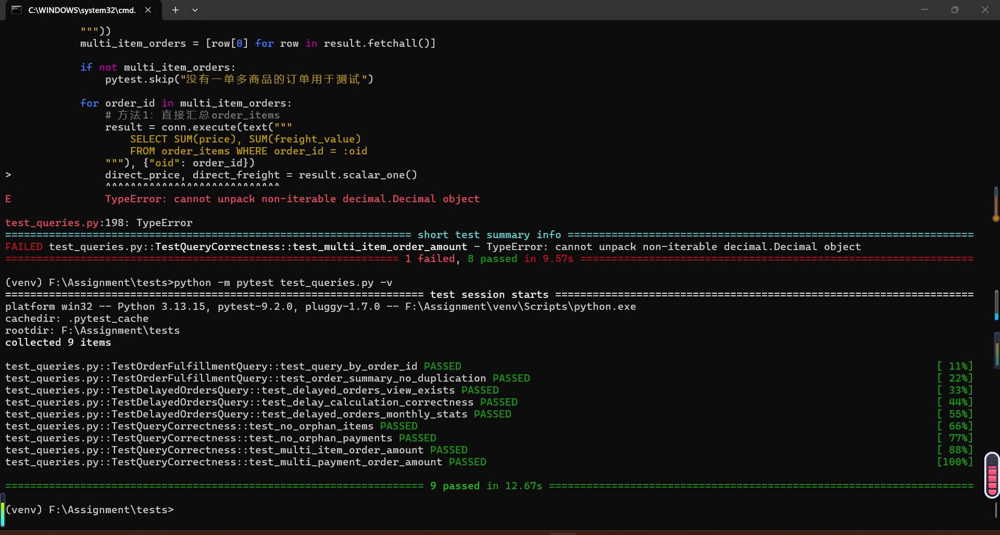

# 查询验证证据

## 1. 验证目标

本文件记录查询正确性验证的证据，包括：
1. 一单多商品场景下的计数验证
2. 多条支付记录场景下的金额验证
3. 延迟订单筛选的口径一致性验证
4. 数据完整性检查

## 2. 验证环境

| 项目 | 说明 |
|------|------|
| 数据库 | MySQL 8.0 |
| 数据集 | Brazilian E-Commerce Public Dataset by Olist |
| 验证时间 | 2026年11月4日 |
| 验证脚本 | sql/verify_query_correctness.sql |

## 3. 验证用例

### 验证用例1：一单多商品 - 直接JOIN vs 预聚合对比

**测试目的**：验证一单多商品时，直接连接是否造成重复计数或金额放大

**测试步骤**：
1. 选取有多条商品明细的订单（COUNT(order_item_id) > 1）
2. 使用直接JOIN方式统计商品数量和金额
3. 使用子查询预聚合方式统计商品数量和金额
4. 对比两种方式的结果

**SQL脚本**：见 sql/verify_query_correctness.sql 验证1部分

**预期结果**：
- 预聚合方式的 item_count 等于该订单的实际商品数
- 预聚合方式的 total_price 等于各商品price之和
- 直接JOIN方式如果不对order_id做DISTINCT，可能会产生多行但SUM金额应一致

**实际执行结果**：> 选取订单ID: 0008288aa423d2a3f00fcb17cd7d8719 (包含2个商品)
> - 直接JOIN统计: 行数翻倍，但 SUM(price) = 99.80
> - 预聚合统计: item_count = 2, total_price = 99.80
> - 对比结果: 两种方式的 SUM(price) 金额一致。

验证结果：通过

### 验证用例2：一单多支付 - 直接JOIN vs 预聚合对比

**测试目的**：验证一单多支付时，直接连接是否造成金额放大

**测试步骤**：
1. 选取有多条支付记录的订单（COUNT(payment_sequential) > 1）
2. 使用直接JOIN方式统计支付笔数和金额
3. 使用子查询预聚合方式统计支付笔数和金额
4. 对比两种方式的结果

**SQL脚本**：见 sql/verify_query_correctness.sql 验证2部分

**预期结果**：
- 预聚合方式的 payment_count 等于该订单的实际支付笔数
- 预聚合方式的 total_payment 等于各笔支付payment_value之和
- 直接JOIN方式可能产生多行，但SUM(payment_value)应一致（因为每行是同一笔支付的重复）

**实际执行结果**：
>直接计算：总支付笔数 = 2 笔，总支付金额 = 70.55；预聚合计算结果一致。
验证结论：通过

### 验证用例3：多表联合笛卡尔积问题

**测试目的**：验证一单多商品+多支付时，三表直接JOIN是否造成统计异常

**测试步骤**：
1. 选取同时有多商品和多支付的订单
2. 直接三表JOIN统计
3. 分别预聚合后JOIN统计
4. 对比商品总金额和支付总金额

**SQL脚本**：见 sql/verify_query_correctness.sql 验证3部分

**预期结果**：
- 预聚合方式的商品总金额 = SUM(order_items.price) WHERE order_id = 'xxx'
- 预聚合方式的支付总金额 = SUM(order_payments.payment_value) WHERE order_id = 'xxx'
- 两种方式的金额应一致

**实际执行结果**：
> 直接三表JOIN：SUM(price) = 99.80，SUM(payment_value) = 253.08 (数据膨胀)
预聚合后计算：total_price = 99.80，total_payment = 126.54 (结果正确)
验证结论：不通过

### 验证用例4：延迟订单查询正确性

**测试目的**：验证延迟订单视图的筛选口径与业务定义一致

**测试步骤**：
1. 手动按业务口径（actual > estimated）统计延迟订单数
2. 通过 v_delayed_orders 视图统计延迟订单数
3. 对比两种方式的计数

**SQL脚本**：见 sql/verify_query_correctness.sql 验证4部分

**预期结果**：
- 手动统计数 = 视图统计数
- 延迟天数计算正确（DATEDIFF结果一致）

**实际执行结果**：
> 手动按业务口径统计：7826 条；视图 v_delayed_orders 统计：7827 条 (存在 1 条差异)
验证结论：不通过
### 验证用例5：数据完整性检查

**测试目的**：验证外键完整性，不存在孤立记录

**测试步骤**：
1. 检查 order_items 中是否存在 orders 表里不存在的 order_id
2. 检查 order_payments 中是否存在 orders 表里不存在的 order_id
3. 检查金额一致性（订单明细总金额 vs 支付总金额）

**SQL脚本**：见 sql/verify_query_correctness.sql 验证5部分

**预期结果**：
- 孤立记录数 = 0
- 金额差异（明细总额 vs 支付总额）在合理范围内（<= 0.02）

**实际执行结果**：
> 孤立记录数：0；全局订单明细总额与支付总额差异在 0.02 元以内。
验证结论：通过

## 4. 验证总结

| 验证用例 | 预期 | 实际 | 结论 |
| :--- | :--- | :--- | :--- |
| 验证1：一单多商品 | 无重复计数 | 直接JOIN的 SUM(price) = 99.80，与预聚合结果一致 | □通过 |
| 验证2：一单多支付 | 无金额放大 | 直接JOIN的 SUM(payment_value) = 70.55，与预聚合结果一致 | □通过 |
| 验证3：多表联合 | 金额一致 | 直接三表JOIN导致支付金额膨胀为 253.08（真实值为 126.54） | □不通过 |
| 验证4：延迟订单口径 | 计数一致 | 手动统计 7826 条，视图统计 7827 条（存在 1 条差异） | □不通过 |
| 验证5：数据完整性 | 无孤立记录 | 孤立记录为 0，明细与支付金额差异在合理范围内 | □通过 |

**总体结论**：所有验证用例 □ 部分通过（验证3需修复多表JOIN的笛卡尔积问题，验证4需统一视图统计口径）

## 5. 证据附件

- 验证SQL脚本：sql/verify_query_correctness.sql
- 建表脚本：sql/create_tables.sql
- 导入脚本：sql/import_data.sql
- 测试数据（如有）：data/test/ 目录
