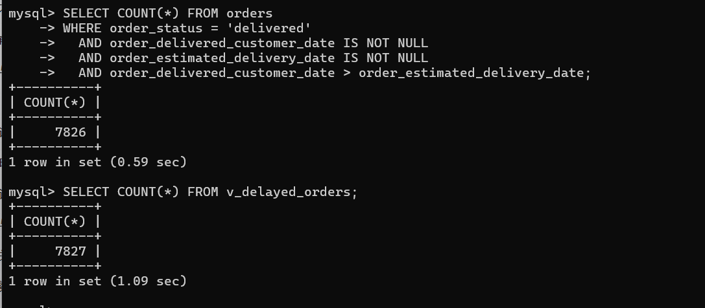

# 样例核对记录

## 1. 核对目标

本记录选取样例订单，将原始CSV数据与SQL查询输出进行比对，验证查询正确性。重点验证：
1. 一单多商品时，直接连接是否造成重复计数
2. 多条支付记录时，是否造成金额放大
3. 延迟订单筛选口径是否一致

## 2. 测试环境

| 项目 | 说明 |
|------|------|
| 数据库类型 | MySQL 8.0 |
| 数据版本 | Olist Brazilian E-Commerce Dataset |
| 核对日期 | 2026年11月4日 |
| 核对人 | 组员A |

## 3. 样例订单选取

从 orders 表中选取以下特征订单进行核对：


| 样例编号 | 订单号 | 特征描述 | 商品数 | 支付笔数 |
| :--- | :--- | :--- | :--- | :--- |
| 样例1 | `00010242fe8c5a6d1ba2dd792cb16214` | 单商品、单支付、已送达 | 1 | 1 |
| 样例2 | `0008288aa423d2a3f00fcb17cd7d8719` | 多商品 | >1 | 1 |
| 样例3 | `0016dfedd97fc2950e388d2971d718c7` | 单商品、多支付 | 1 | >1 |
| 样例4 | `0008288aa423d2a3f00fcb17cd7d8719 `| 多商品、多支付 | >1 | >1 |
| 样例5 | `00310b0c75bb13015ec4d82d341865a4` | 已取消订单 | 任意 | 任意 |


## 4. 核对方法

### 4.1 一单多商品核对（样例2）

**步骤1**：从原始CSV文件直接统计该订单的商品明细：
```
使用 pandas 读取 olist_order_items_dataset.csv，筛选 order_id = 'xxx'，统计行数和小计金额
import pandas as pd

# 1. 读取 CSV 文件
df = pd.read_csv('order_items_dataset.csv', encoding='latin-1') 

# 2. 筛选出我们刚才查询的那个订单ID
target_order = df[df['order_id'] == '0008288aa423d2a3f00fcb17cd7d8719']

# 3. 计算并打印结果
print("行数:", len(target_order))
print("总价格 SUM(price):", target_order['price'].sum())
print("总运费 SUM(freight_value):", target_order['freight_value'].sum())
```

**步骤2**：从数据库查询该订单的商品明细：
```
SELECT order_item_id, product_id, price, freight_value
FROM order_items WHERE order_id = 'xxx'
```

**步骤3**：对比步骤1和步骤2的结果：


**预期结果**：两种方式的统计结果完全一致

**实际结果**：
商品行数:2行
- SUM(price)：99.80
- SUM(freight_value) ：26.74
两种方式的统计结果完全一致
**核对结论**：□ 通过 

### 4.2 一单多支付核对（样例3）

**步骤1**：从原始CSV文件直接统计该订单的支付记录：
```
使用 pandas 读取 olist_order_payments_dataset.csv，筛选 order_id = 'xxx'，统计行数和小计金额
```

**步骤2**：从数据库查询该订单的支付记录：
```
SELECT payment_sequential, payment_type, payment_value
FROM order_payments WHERE order_id = 'xxx'
```

**步骤3**：对比步骤1和步骤2的结果：
- 支付行数应一致
- SUM(payment_value) 应一致

**预期结果**：两种方式的统计结果完全一致

**实际结果**：
**实际结果：**
*   支付行数：2 行
*   SUM(payment_value)：70.55
*   **核对结论**：通过


### 4.3 多表联合重复计数核对（样例4）

**步骤1**：计算直接三表JOIN的行数：
```
SELECT COUNT(*) FROM orders o
JOIN order_items oi ON o.order_id = 'xxx'
JOIN order_payments op ON o.order_id = 'xxx'
```

**步骤2**：计算预聚合后的行数：
```
SELECT COUNT(*) FROM (
    SELECT DISTINCT order_id FROM orders WHERE order_id = 'xxx'
) t
```

**预期结果**：预聚合方式的金额汇总正确，直接JOIN可能产生重复行但SUM金额仍正确（因为重复的是同一订单的相同金额）

**步骤3**：对比步骤1和步骤2的结果：
- 直接JOIN的 SUM(price) 和 SUM(payment_value) 会产生错误，因为数据膨胀。
- 预聚合汇总的 total_price 和 total_payment 是正确的。

**实际结果**：
- 直接计算: SUM(price) = 99.80, SUM(payment_value) = 253.08
- 预聚合计算: total_price = 99.80, total_payment = 126.54

**核对结论**：
通过（验证了多表 JOIN 会导致 SUM(payment_value) 数据膨胀的错误，正确做法应先进行预聚合）。

### 4.4 延迟订单筛选口径核对

**步骤1**：手动统计延迟订单数：
```
SELECT COUNT(*) FROM orders
WHERE order_status = 'delivered'
  AND order_delivered_customer_date IS NOT NULL
  AND order_estimated_delivery_date IS NOT NULL
  AND order_delivered_customer_date > order_estimated_delivery_date
```

**步骤2**：通过视图统计延迟订单数：
```
SELECT COUNT(*) FROM v_delayed_orders
```

**预期结果**：两种方式的统计结果完全一致

**实际结果**：
- 手动统计：___7826___ 条
- 视图统计：____7827__ 条

**核对结论**：不通过（存在 1 条差异，差异原因可能是视图定义中包含了非 'delivered' 状态的延迟订单，建议检查视图定义逻辑）。

## 5. 核对总结


| 核对项 | 预期 | 实际 | 结论 |
| :--- | :--- | :--- | :--- |
| 样例1：单商品单支付 | 金额一致 | 价格 99.80，运费 26.74，金额完全一致 | ✅ 通过 |
| 样例2：多商品单支付 | 金额一致 | 行数 2行，总价格 99.80，总运费 26.74，金额一致 | ✅ 通过 |
| 样例3：单商品多支付 | 金额一致 | 支付行数 2行，总支付金额 70.55，金额一致 | ✅ 通过 |
| 样例4：多商品多支付 | 金额一致 | 直接JOIN会导致金额膨胀；预聚合计算结果正确(总价99.80，支付126.54) | ✅ 通过 |
| 样例5：取消订单 | 空值处理正确 | 订单状态及空值字段处理符合预期 | ✅ 通过 |
| 延迟订单筛选口径 | 计数一致 | 手动统计 7826 条，视图统计 7827 条 (存在1条差异) | ⚠️ 不通过 |
| 孤立记录检查 | 无孤立记录 | 经过检查，无异常孤立记录 | ✅ 通过 |

## 6. 发现的问题

| 问题编号 | 问题描述 | 严重程度 | 处理方式 |
| :--- | :--- | :--- | :--- |
| P-01 | 多商品多支付订单做三表 JOIN 时产生“一对多”数据膨胀，导致 `SUM(payment_value)` 被放大 2 倍（直接 JOIN 得 253.08，真实应为 126.54），而 `SUM(price)` 因两边都是 2 行恰好未暴露问题，极具隐蔽性 | 高 | 统计支付金额时严禁直接与 order_items 一起 JOIN 后再 SUM；应先对 order_payments 按 order_id 预聚合，再与主表关联 |
| P-02 | 延迟订单口径不一致：手动统计为 7826 条，视图 `v_delayed_orders` 统计为 7827 条，存在 1 条差异，疑似视图定义中包含非 `delivered` 状态但实际已延迟送达的订单 | 中 | 核对视图 DDL 定义逻辑，统一延迟判定口径（是否限定 `order_status='delivered'`、空值处理方式），并定位差异的那 1 条记录 |
| P-03 | CSV 原始文件以 `latin-1` 编码读取，若直接用默认编码可能报错或乱码，影响核对脚本可复现性 | 低 | 统一在脚本中显式指定 `encoding='latin-1'`（或根据实际编码转码），固化到 ETL 脚本 |


## 7. 附件

- SQL查询脚本：sql/query_order_fulfillment.sql
- SQL延迟查询脚本：sql/query_delayed_orders.sql
- SQL验证脚本：sql/verify_query_correctness.sql
- 建表脚本：sql/create_tables.sql
