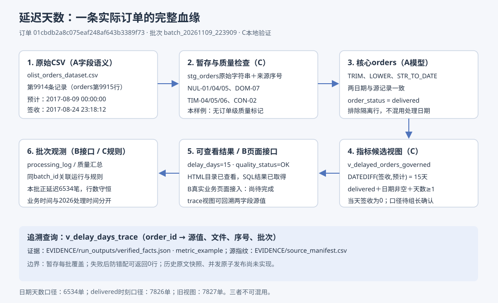

# 核心履约指标血缘：延迟天数

指标责任：字段来源/含义由A解释，质量与候选口径由C定义，批次采集和页面接入由B实现，业务口径由组长确认。本文件的页面结果是已验证视图返回及静态元数据页面，不是B生产页面已接入证明。

## 1. 统一候选口径

粒度为一笔订单一行。`delay_days = DATEDIFF(order_delivered_customer_date, order_estimated_delivery_date)`；纳入delivered且签收/预计两日期非空的订单；延迟筛选为delay_days≥1。下单时间用于业务区间筛选，处理时间用于批次时效，二者不混用。源日期为未附时区的本地字符串；本原型不擅自转成UTC，不声称24小时精确耗时。

MySQL DATEDIFF只比较日期部分，因此正延迟天数不是签收与预计时刻相差秒数除以86400。预计时间在本数据中均为00:00:00，当天15:30签收的DATEDIFF为0。A原有材料同时出现“实际时刻>预计时刻”和“延迟天数>0”，两者不能视为等价。

| 指标/视图 | 实际订单数 |
|---|---:|
| A现有v_delayed_orders，无状态限定且按时刻比较 | 7827 |
| delivered且按时刻比较 | 7826 |
| delivered且DATEDIFF≥1（治理候选口径） | 6534 |
| 两个delivered口径间当天签收差额 | 1292 |

治理候选视图与A原视图并存，不修改A的查询文件。最终采用哪个口径，须组长确认后由B接入页面。

## 2. 一条完整血缘（实际数据）



| 层级 | 对象/字段 | 纳入与转换 | 实际证据 |
|---|---|---|---|
| 源文件 | archive/olist_orders_dataset.csv | UTF-8 CSV；order_status、签收、预计日期 | SHA-256及记录数见EVIDENCE/source_manifest.csv |
| 源记录 | order_id=01cbdb2a8c075eaf248af643b3389f73 | 第9914条数据记录（orders文件第9915行） | 签收2017-08-24 23:18:12；预计2017-08-09 00:00:00；delivered |
| 暂存 | stg_orders | 原始字符串；记录batch_id/src_file/src_row_num | batch_20261109_223909 |
| 质量 | quality_check_summary/data_quality_flags | NUL-01/04/05、DOM-07、TIM-04/05/06、CON-02 | 本样例订单级标记为空 |
| 核心表 | orders | TRIM、LOWER(status)、STR_TO_DATE；保留允许的NULL，排除隔离行 | 核心日期与原始值一致 |
| 指标视图 | v_delayed_orders_governed.delay_days | DATEDIFF(2017-08-24,2017-08-09) | 15天；quality_status=OK |
| 可查看结果 | metadata_catalog.html“指标血缘”及SQL视图 | 字段来源、条件、计算规则可查看 | 已在浏览器验证；B实际查询页面待接入 |
| 批次观测 | processing_log、observability_events | 同batch_id记录运行状态、行数、延迟订单数 | 全批延迟6534单；行数守恒通过 |

orders源文件为单行结构，src_row_num+1对应文件行号；评价自由文本可含换行，对其src_row_num应解释为CSV数据记录序号，不能直接当物理文本行号。

## 3. 查询示例

```sql
SELECT order_id, delay_days, order_status,
       core_delivered_customer_date, core_estimated_delivery_date,
       raw_delivered_customer_date, raw_estimated_delivery_date,
       src_file, src_row_num, csv_line_no, batch_id, flag_rules
FROM v_delay_days_trace
WHERE order_id = '01cbdb2a8c075eaf248af643b3389f73';
```

预期/已取得结果：一行，delay_days=15，src_row_num=9914，csv_line_no=9915，batch_id=batch_20261109_223909。原始两日期与核心表两日期一致；完整返回保存在 `EVIDENCE/run_outputs/verified_facts.json` 的metric_example。

```sql
SELECT order_id, delay_days, quality_status, flag_rules
FROM v_delayed_orders_governed
WHERE order_purchase_timestamp >= '2017-01-01'
  AND order_purchase_timestamp <  '2018-01-01'
ORDER BY delay_days DESC, order_id;
```

时间范围采用左闭右开；不加入一对多明细表，因此订单不会被多商品、多支付放大。若需要金额，明细与支付必须分别预聚合后连接，不使用SUM(DISTINCT金额)作为替代。

## 4. 对血缘本身的验证和局限

合成测试O02的15日签收减10日预计=5天，视图返回5，源记录序号2；O03当天签收不入延迟视图；O04 canceled不纳入；O07延迟2天但附TIM-04标记。45条规则计数/键核对和7项测试通过，证据见EVIDENCE/governance_test_evidence.md。

数据库血缘表metric_lineage记录7个步骤；字段目录记录来源和转换；OpenLineage风格JSON导出了run/job/inputs/outputs/columnLineage。只验证本地JSON可解析，未做标准schema完整校验或Marquez/OpenMetadata接收验证；自定义facet含占位schema地址，不能宣称已标准集成。

暂存层每批覆盖，不保留历史原文版本；当前视图通过batch_id相等防止错配。构建前失败且暂存被覆盖时，逐单追溯明确返回0行，属于“可用性下降但不提供错误血缘”。历史追溯需增设不可变批次快照/来源映射。源文件指纹只证明本次读取版本，不能代替长期审计、源系统真实性或签名证明。

## 5. 依据

[MySQL日期函数](https://dev.mysql.com/doc/refman/8.0/en/date-and-time-functions.html)；[OpenLineage对象模型](https://openlineage.io/docs/spec/object-model/)；A原始DOCS/DATA_MODEL/lineage_info.md、SQL/create_tables.sql.sql（只读参照）。
